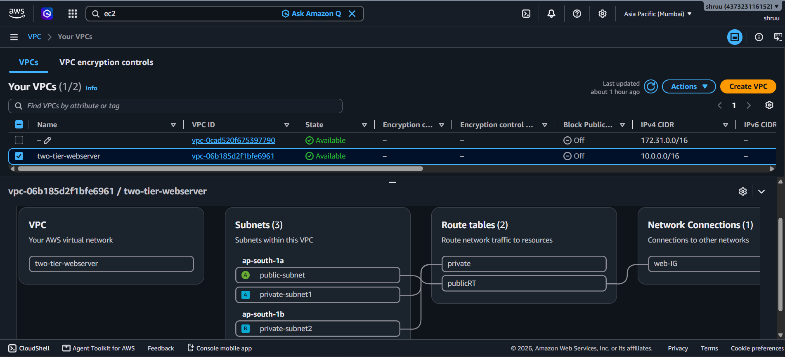
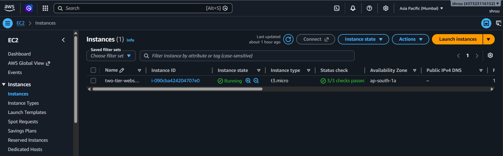
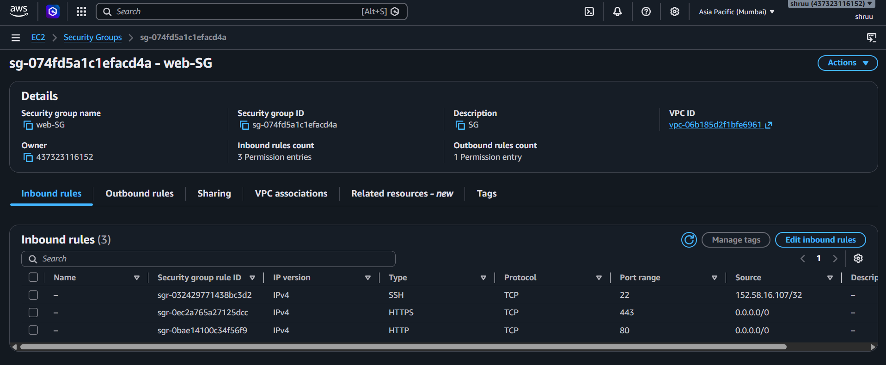
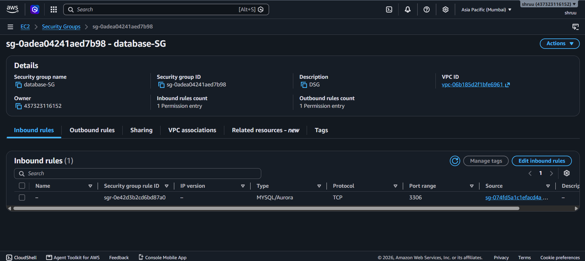
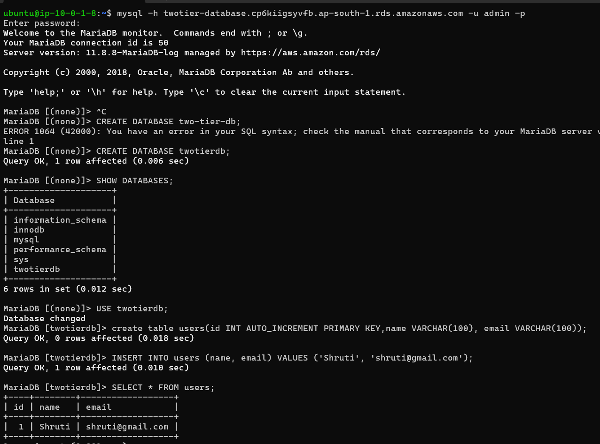
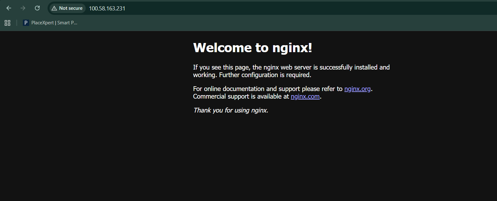

# Two-Tier AWS Application — EC2 + RDS MariaDB

## 📌 Project Overview

This project demonstrates how to deploy a **secure two-tier web application on AWS** using an Ubuntu EC2 web server and Amazon RDS MariaDB.

The architecture separates the **web tier** and **database tier** into different network layers. The EC2 instance is placed in a public subnet and runs **Nginx**, while Amazon RDS MariaDB is placed in private subnets and is not directly accessible from the Internet.

The database is secured using a dedicated Security Group that allows MariaDB traffic on port `3306` **only from the EC2 web server Security Group**.

---

## 🏗️ Architecture

```text
                         INTERNET
                            │
                            │ HTTP : 80
                            ▼
                  ┌─────────────────────┐
                  │    Internet Gateway │
                  └──────────┬──────────┘
                             │
                             ▼
                  ┌─────────────────────┐
                  │    Public Route     │
                  │       Table         │
                  └──────────┬──────────┘
                             │
                             ▼
             ┌──────────────────────────────┐
             │       Public Subnet          │
             │       ap-south-1a            │
             │                              │
             │  Ubuntu EC2 + Nginx          │
             │  WebServer-SG                │
             └──────────────┬───────────────┘
                            │
                            │ TCP 3306
                            │
                            ▼
             ┌──────────────────────────────┐
             │       Private Subnets        │
             │                              │
             │  Private-Subnet-1            │
             │  ap-south-1a                 │
             │                              │
             │  Private-Subnet-2            │
             │  ap-south-1b                 │
             │                              │
             │       Amazon RDS              │
             │       MariaDB                 │
             │       Database-SG              │
             └──────────────────────────────┘
```

---

## 🎯 Project Objectives

* Create a custom AWS VPC.
* Create public and private subnets.
* Deploy an Ubuntu EC2 instance in the public subnet.
* Install and configure Nginx.
* Create Amazon RDS MariaDB in private subnets.
* Configure separate Security Groups for EC2 and RDS.
* Allow database access only from the EC2 Security Group.
* Disable public access to RDS.
* Test secure EC2-to-RDS database connectivity.

---

# ☁️ AWS Services Used

| Service          | Purpose                                       |
| ---------------- | --------------------------------------------- |
| Amazon VPC       | Creates the isolated network                  |
| Subnets          | Separates public and private resources        |
| Internet Gateway | Provides Internet access to the public subnet |
| Route Tables     | Controls network traffic                      |
| Amazon EC2       | Hosts the Ubuntu web server                   |
| Nginx            | Web server                                    |
| Amazon RDS       | Managed database service                      |
| MariaDB          | Relational database engine                    |
| Security Groups  | Controls inbound and outbound traffic         |
| SSH              | Secure EC2 administration                     |

---

# 🌐 Network Architecture

## VPC

```text
VPC Name: TwoTier-VPC
CIDR: 10.0.0.0/16
```

## Subnets

| Subnet          | Availability Zone | Type    | Purpose            |
| --------------- | ----------------- | ------- | ------------------ |
| public-subnet   | ap-south-1a       | Public  | Ubuntu EC2 + Nginx |
| private-subnet1 | ap-south-1a       | Private | RDS                |
| private-subnet2 | ap-south-1b       | Private | RDS                |

The two private subnets are located in different Availability Zones so they can be used for the RDS DB subnet group.

---

# 🚦 Route Table Configuration

## Public Route Table

```text
Route Table: publicRT

Destination       Target
10.0.0.0/16       local
0.0.0.0/0         Internet Gateway
```

Association:

```text
publicRT
    ↓
public-subnet
```

This allows the EC2 web server to communicate with the Internet.

## Private Subnets

The private subnets are associated with a route table that does not contain a direct Internet Gateway route.

```text
private-subnet1
        │
        ▼
private route table

private-subnet2
        │
        ▼
private route table
```

The RDS database is therefore not directly exposed to the Internet.

---

# 🔐 Security Groups

## WebServer-SG

The EC2 instance uses:

```text
Security Group: Web-SG
```

### Inbound Rules

| Type | Port | Source    | Purpose                      |
| ---- | ---: | --------- | ---------------------------- |
| SSH  |   22 | My IP     | Secure server administration |
| HTTP |   80 | 0.0.0.0/0 | Web access                   |

SSH should be restricted to the administrator's IP address rather than being open to the entire Internet.

---

# 🗄️ Database-SG

The RDS instance uses:

```text
Security Group: Database-SG
```

### Inbound Rules

| Type         | Port | Source       | Purpose                        |
| ------------ | ---: | ------------ | ------------------------------ |
| MySQL/Aurora | 3306 | WebServer-SG | EC2-to-RDS database connection |

The database Security Group does **not** allow:

```text
0.0.0.0/0
```

on port `3306`.

Therefore, only resources associated with `Web-SG` can initiate MariaDB connections to the RDS instance.

---

# 🖥️ EC2 Web Server

## EC2 Configuration

```text
Operating System: Ubuntu Server
Server: Nginx
Subnet: public-subnet
Security Group: Web-SG
Public IP: Enabled
```

## Connect to EC2

From a local machine:

```bash
ssh -i <key-file>.pem ubuntu@<EC2-PUBLIC-IP>
```

Example:

```bash
ssh -i shruti.pem ubuntu@<EC2-PUBLIC-IP>
```

---

# ⚙️ Install Nginx

Update Ubuntu packages:

```bash
sudo apt update
```

Install Nginx:

```bash
sudo apt install nginx -y
```

Start Nginx:

```bash
sudo systemctl start nginx
```

Enable Nginx at boot:

```bash
sudo systemctl enable nginx
```

Check the service:

```bash
sudo systemctl status nginx
```

Expected status:

```text
active (running)
```

---

# 🌍 Test Nginx

Open a browser and visit:

```text
http://<EC2-PUBLIC-IP>
```

The Nginx welcome page should be displayed.

---

# 🗃️ Amazon RDS MariaDB

## RDS Configuration

```text
Engine: MariaDB
Database: MariaDB
Port: 3306
Public Access: No
VPC: TwoTier-VPC
Security Group: Database-SG
```

The RDS instance is placed in a DB subnet group containing:

```text
private-subnet1
private-subnet2
```

The database does not have a public IP and cannot be accessed directly from the Internet.

---

# 🔗 DB Subnet Group

Create an RDS DB subnet group containing private subnets from two Availability Zones.

```text
DB Subnet Group:
twotier-db-subnet-group

Subnet 1:
private-subnet1
ap-south-1a

Subnet 2:
private-subnet2
ap-south-1b
```

---

# 🔌 Secure Database Connectivity

Install the MariaDB client on the Ubuntu EC2 server:

```bash
sudo apt update
sudo apt install mariadb-client -y
```

Check the client:

```bash
mysql --version
```

Connect to RDS using its endpoint:

```bash
mysql -h <RDS-ENDPOINT> -u admin -p
```

Example:

```bash
mysql -h twotier-database.xxxxxxxxx.ap-south-1.rds.amazonaws.com -u admin -p
```

After entering the password:

```text
MariaDB [(none)]>
```

This confirms that the EC2 web server can securely communicate with the private RDS database.

---

# 🧪 Database Testing

Create a database:

```sql
CREATE DATABASE twotierdb;
```

Select the database:

```sql
USE twotierdb;
```

Create a table:

```sql
CREATE TABLE users (
    id INT AUTO_INCREMENT PRIMARY KEY,
    name VARCHAR(100),
    email VARCHAR(100)
);
```

Insert sample data:

```sql
INSERT INTO users (name, email)
VALUES ('Shruti', 'shruti@gmail.com');
```

Display the data:

```sql
SELECT * FROM users;
```

Expected result:

```text
+----+--------+---------------------+
| id | name   | email               |
+----+--------+---------------------+
|  1 | Shruti | shruti@gmail.com  |
+----+--------+---------------------+
```

---

# 🔒 Security Implementation

The project follows a basic secure network design:

```text
Internet
   │
   │ HTTP : 80
   ▼
EC2 + Nginx
   │
   │ TCP : 3306
   │
   ▼
RDS MariaDB
```

### Security controls

* RDS public access is disabled.
* RDS is placed in private subnets.
* Database port `3306` is not open to the Internet.
* Database access is allowed only from `Web-SG`.
* SSH access is restricted to the administrator's IP.
* HTTP access is allowed for the web application.
* Separate Security Groups are used for the web and database tiers.

---

# 📸 Project Screenshots

The following screenshots demonstrate the project implementation:

### 1. VPC



### 2. EC2 Ubuntu Web Server



### 3. WebServer Security Group



### 4. Database Security Group



### 5. RDS Connectivity



### 6. Nginx Web Page



---

# 📁 Project Structure

```text
two-tier-aws-application/
│
├── README.md
│
└── screenshots/
    ├── 01-vpc.png
    ├── 02-ec2.png
    ├── 03-web-security-g.png
    ├── 04-database-SG.png
    ├── 05-database.png
    ├── 06-nginx-connect.png
```

---

# ✅ Project Validation

The project is considered successfully implemented when:

* [x] Custom VPC is created.
* [x] Public subnet is created.
* [x] Two private subnets are created in different Availability Zones.
* [x] Public route table is configured with an Internet Gateway.
* [x] Ubuntu EC2 is deployed in the public subnet.
* [x] Nginx is installed and running.
* [x] RDS MariaDB is deployed in private subnets.
* [x] Separate Security Groups are configured.
* [x] RDS public access is disabled.
* [x] Port 3306 allows access only from `Web-SG`.
* [x] EC2 successfully connects to RDS.
* [x] Database and table operations are successfully tested.

---

# 🧠 What I Learned

Through this project, I practiced:

* AWS VPC networking
* Public and private subnet design
* Availability Zones
* Route tables and Internet Gateway
* EC2 deployment
* Ubuntu Linux administration
* Nginx configuration
* Amazon RDS
* MariaDB
* Security Groups
* Database connectivity
* Basic AWS security architecture
* Troubleshooting network and database connectivity

---

# 🔑 Key Architecture Principle

```text
PUBLIC TIER
EC2 + Nginx
      │
      │ Only database traffic
      ▼
PRIVATE TIER
RDS MariaDB
```

The database is **not directly exposed to the Internet**.

---

## Author

**Shruti More**

Cloud Computing / AWS | Linux | Nginx | DevOps

GitHub: [mshruti759](https://github.com/mshruti759)
